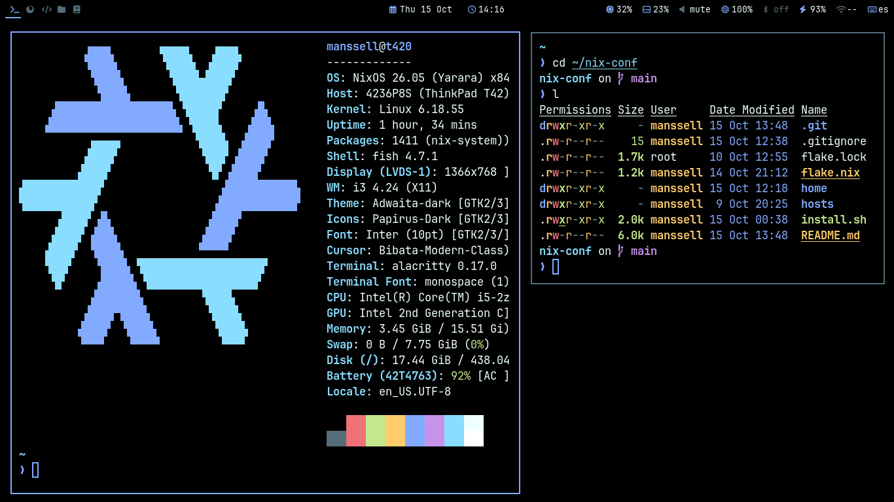
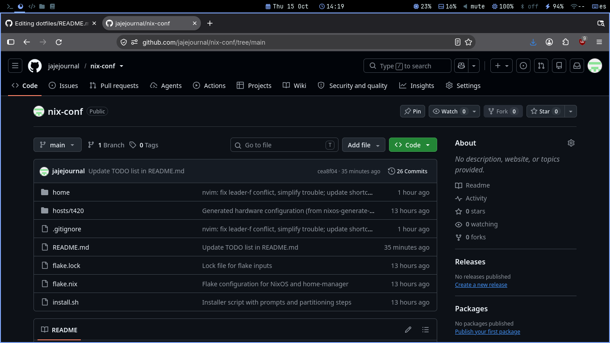
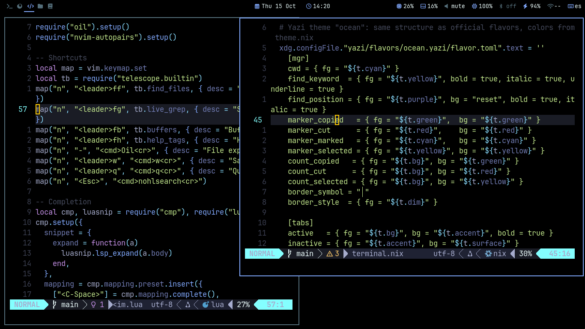
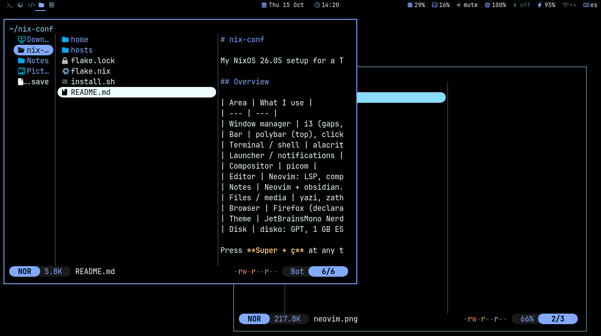
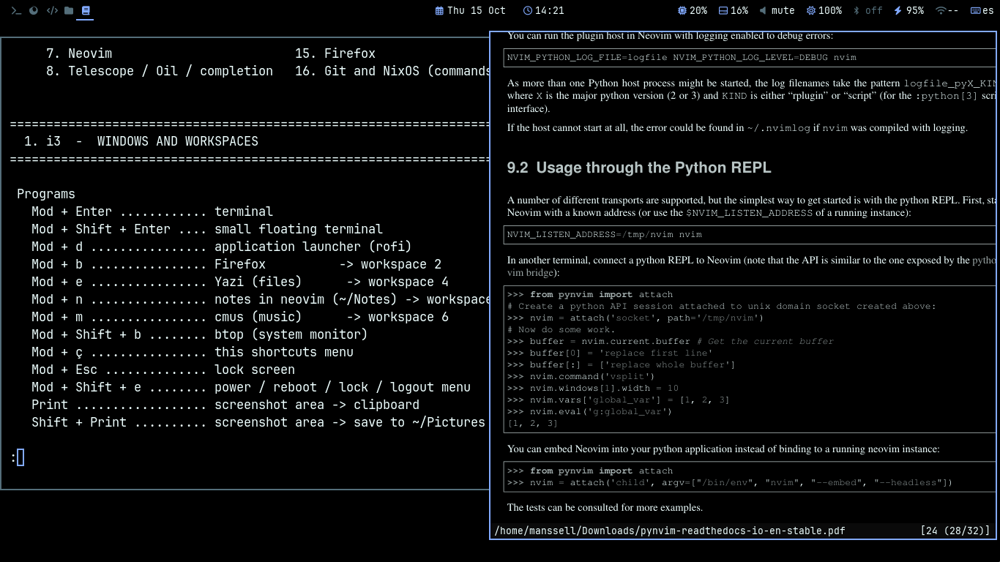

# nix-conf

My NixOS 26.05 setup for a ThinkPad T420: **flakes + home-manager + disko**, with an **i3** desktop on X11 (started with `startx`, no display manager). Pure black theme with Material Ocean accents, all driven from a single file.

## Screenshots

  <table>
    <!-- Primera fila: 3 capturas -->
    <tr>
      <td width="33%"></td>
      <td width="33%"></td>
      <td width="33%"></td>
    </tr>
    <!-- Segunda fila: 2 capturas centradas -->
    <tr>
      <td width="33%"></td>
      <td width="33%"></td>
    </tr>
  </table>

## Overview

| Area | What I use |
| --- | --- |
| Window manager | i3 (gaps, vim-style keys) |
| Bar | polybar (top), clickable modules |
| Terminal / shell | alacritty, fish, starship, zoxide, fzf, eza, bat |
| Launcher / notifications | rofi, dunst |
| Compositor | picom |
| Editor | Neovim: LSP, completion, format on save (conform), diagnostics panel (trouble), start screen (alpha) |
| Notes | Neovim + obsidian.nvim, vault in `~/Notes` |
| Files / media | yazi, zathura, mpv, imv, cmus |
| Browser | Firefox (declarative profile) |
| Theme | JetBrainsMono Nerd Font + Inter, colors from `home/theme.nix` |
| Disk | disko: GPT, 1 GB ESP + ext4 root (LUKS optional) |

Press **Super + ç** at any time to open the shortcuts cheatsheet (`home/shortcuts.txt`).

## Repository layout

```
nix-conf/
├── flake.nix
├── install.sh                 # fresh install: disko + nixos-install
├── hosts/t420/
│   ├── default.nix
│   ├── disko.nix              # disk layout (used only by t420-install)
│   └── hardware-configuration.nix
├── home/
│   ├── default.nix
│   ├── theme.nix
│   ├── i3.nix  polybar.nix
│   ├── nvim.nix  nvim.lua
│   └── shortcuts.txt
└── assets/
    └──screenshots...

```

## Flake outputs

| Output | Use |
| --- | --- |
| `.#t420` | An already installed NixOS system (daily use) |
| `.#t420-install` | Fresh install with disko, used by `install.sh` |

## Installation

### Option A: NixOS is already installed (nothing is wiped)

```sh
nix-shell -p git openssl
git clone https://github.com/jajejournal/nix-conf && cd nix-conf

# Reuse this machine's hardware config
cp /etc/nixos/hardware-configuration.nix hosts/t420/
git add -f hosts/t420/hardware-configuration.nix

# Password hash (never stored in the repo)
sudo mkdir -p /etc/secrets
openssl passwd -6 | sudo tee /etc/secrets/password-hash >/dev/null
sudo chmod 600 /etc/secrets/password-hash

sudo nixos-rebuild switch --flake .#t420
```

### Option B: fresh install from the minimal ISO (erases the whole disk)

1. Boot the NixOS minimal ISO, then `sudo loadkeys es` and connect to the network.
2. `git clone https://github.com/jajejournal/nix-conf && cd nix-conf`
3. In `hosts/t420/disko.nix`, set `device` to your disk (`ls -l /dev/disk/by-id/`).
4. `sudo ./install.sh`

The script asks for the password, generates the hardware config, checks that the configuration evaluates **before** touching the disk, asks you to type `YES`, partitions with disko (LUKS passphrase prompt), installs, and copies the repo to `~/nix-conf`.

After rebooting, log in and run `startx`.

> LUKS is controlled by `useLuks` in `hosts/t420/disko.nix` (on by default). Only fresh installs with `install.sh` are encrypted; Option A keeps whatever the existing system has.

## Daily use

```sh
cd ~/nix-conf
sudo nixos-rebuild switch --flake .#t420   # apply changes
nix flake update                           # update inputs (then rebuild)
git add -A && git commit && git push
```

Nix flakes only see files tracked by git, so run `git add` on new files before rebuilding.

## Customizing

- **Colors and fonts:** edit `home/theme.nix`. i3, polybar, alacritty, rofi, dunst, yazi, zathura and tmux all follow it.
- **Programs:** add packages in `home/apps.nix` (terminal tools) or `home/default.nix`.
- **Neovim:** plugins and language servers in `home/nvim.nix`, behavior in `home/nvim.lua`. LSP servers and formatters come from Nix, so there is no Mason.
- **Shortcuts:** keep `home/shortcuts.txt` in sync when you change keybindings.

## Neovim quick reference

Leader key is `Space`.

| Keys | Action |
| --- | --- |
| `<leader>ff` / `fg` / `fb` | Find files / search text / buffers |
| `-` | File explorer (oil) |
| `gd` / `K` | Go to definition / hover docs |
| `<leader>rn` / `ca` | Rename / code actions |
| `<leader>cf` | Format file (also automatic on save) |
| `<leader>xx` / `xd` | Project / file diagnostics (trouble) |
| `<leader>on` / `of` / `od` | New note / find note / today's note |

Languages with LSP: Python, JS/TS, Java, SQL, Go, C/C++, Rust, Nix, Lua, Bash, HTML/CSS/JSON, YAML, Markdown.

## Secrets

No passwords or keys are stored in this repo. User and root passwords are read from a hash in `/etc/secrets/password-hash`, created with `openssl passwd -6`.

## Troubleshooting

- **Home-manager fails on an existing file** (e.g. Firefox `profiles.ini`): the flake already sets `backupFileExtension = "backup"`, so the old file is renamed.
- **A package name does not exist:** names change between nixpkgs branches. Search with `nix search nixpkgs <name>`.
- **Conform does not format a language:** make sure its formatter (black, prettier, stylua...) is in `extraPackages` in `home/nvim.nix`.
- **Trouble:** this config uses Trouble v3 (`:Trouble diagnostics toggle`). The old v2 `:TroubleToggle` commands do not exist.
- **Backlight module empty in polybar:** check your device with `ls /sys/class/backlight/`. The T420 uses `acpi_video0`.
- **A polybar click does nothing:** scripts run with a minimal PATH, so use absolute paths (`${pkgs.foo}/bin/foo`).

## TODO

Not implemented yet; planned for when I have another laptop:

- [x] Try not to use the translator so much.
- [ ] One folder per machine under `hosts/<name>/`
- [ ] `install.sh` with hardware detection and disk selection
- [ ] "Lite" profile for low-RAM machines
- [x] Add screenshots to the README
